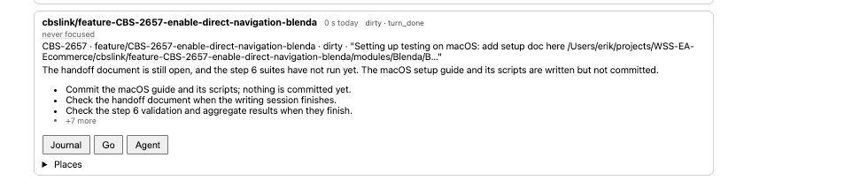

When I check in the web UI I see

it has been focused today, several times still says "never focused"

Cause: the IDE window of that checkout (opened after IntelliJ last saved `recentProjects.xml`) had no folder, so its
focus went to the IntelliJ app item, and the Claude session in its terminal had no window. Fixed in appcontext and the
resolver's JetBrains join (decision 0062); the daemon needs a restart.
